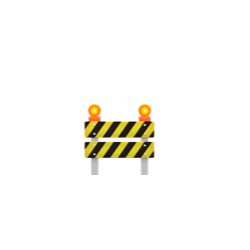

> [!NOTE]
> This repository is a mirror. The mod is developed in a private monorepo, and this copy is updated on every
> release with only the game files and source code. Get the mod on the [Steam Workshop](https://steamcommunity.com/sharedfiles/filedetails/?id=3650035249).
>
> Issues and pull requests are welcome. Pull requests aren't merged here: accepted changes are applied in the
> monorepo with you as the author, show up here with the next release, and the pull request is closed with a
> link to the commit.

## **_Adds many granular categories to the game and dynamically assigns them to ALL items based on their properties_**

## **_Dynamically updates the category of food and liquid items based on their state_**

## **_Unique color for each category in the UI (can be toggled off in mod settings)_**

## **_Choose how detailed the categories are: Hoarder, Balanced or Lite (in mod settings)_**

[header]categories[/header]

The following broad categories of items are covered:

🍗 **Foods**            → Perishable, Canned, Preserved, Prepared, Meat, Fish, Produce, Dairy, Condiments, Spices, Frozen and _much_ more
🍹 **Beverages**        → Alcohol, Water, Tea, Coffee, Soft Drink, Cocktail, etc, with dynamic categorization based on container contents
👕 **Apparel**          → Clothing, Protective Gear and accessories divided into categories like Footwear, Socks, Top, Outerwear, Headwear, Gloves, Underwear, etc. Sturdy gear with high scratch, bite or bullet protection, like boots, is now "**Protective Gear**" instead of "**Clothing**"
📚 **Literature**       → Magazines, Hardcovers, Picture Books, Brochures, Fliers, Recipes, Writing and more. Useless items such as phone books are "Literature / Junk".
⚔️ **Weapon**           → Melee weapons divided by skill type, guns into Pistols, Rifles, Shotguns. Weapons that are also something else show both, such as "**Cooking - Utensil / Weapon - Short Blade**" for kitchen knives
🔫 **Ammo**             → Ammo divided in Rifle, Shotgun and Handgun and then in Magazine, Box and Carton
🪴 **Gardening**        → Seeds, seed packets, animal feed and compostable items
🍳 **Cooking**          → Utensils, cutlery, pans, cups and more
🛠️ **Tools**           → Categorized by skills
🧱 **Materials**        → Categorized by skills and/or material types
🖌️ **Construction**     → Paint, plaster, wallpaper and the tools to apply them
📦 **Packages**         → Get their own categories based on the contained item, such as "**Material - Box**"
🪥 **Household**        → Items like toilet paper and tissues, and cleaning supplies
😷 **Gas mask filters** → Categorized as Protective Gear - Accessory
🚬 **Smoking**          → Smoking instead of Junk
🦝 **Plushies**         → All Dog, Duck, Raccoon (etc.) categories are combined into "**Memento - Plushie**"

This also dynamically changes the categories of water containers based on their contents. For example, a bottle of soda will be categorized as "**Beverage - Soft Drink**", while an empty bottle, carton, mug or anything else that holds liquids will be categorized as "**Container - Liquid**" rather than "**Food**" or "**Water**".

You can even mix some booze into your soda, and it will be categorized as "**Beverage - Cocktail**"!

[header]category detail[/header]

**🚧 work in progress!**

Prefer fewer categories? Pick a detail level in the mod settings:

The change is applied after you return to the main menu and load or join the game again.

This feature is in the trial phase right now and it doesn't affect many categories yet. Please help me out with this because obviously I prefer "Hoarder" and I don't know how much to flatten :P

[header]compatibility[/header]

See the [Compatibility discussion](https://steamcommunity.com/sharedfiles/filedetails/?id=3650035249). Short answer is "Yes it works, if not let me know".
